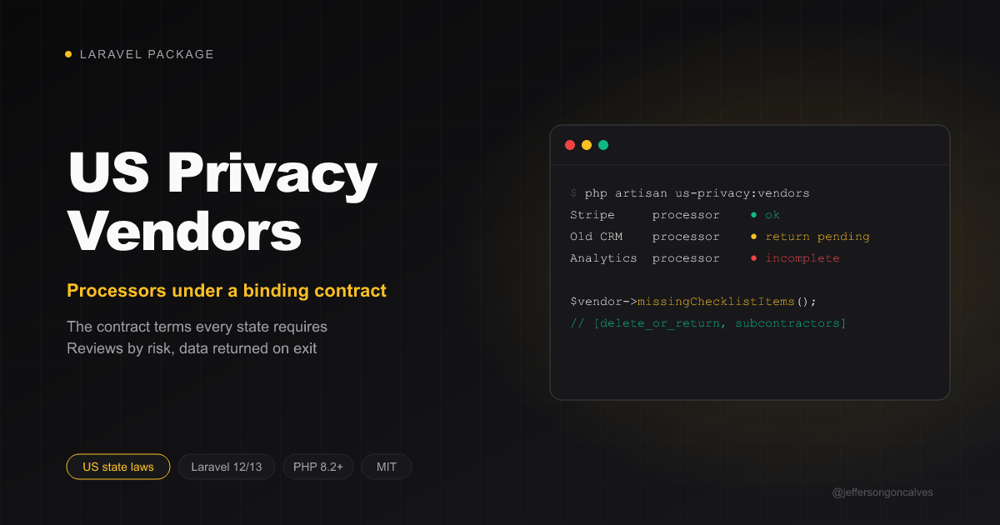

# Laravel US Privacy Vendors



[](https://packagist.org/packages/jeffersongoncalves/laravel-us-privacy-vendors)
[](https://github.com/jeffersongoncalves/laravel-us-privacy-vendors/actions/workflows/tests.yml)
[](https://packagist.org/packages/jeffersongoncalves/laravel-us-privacy-vendors)

A register of the processors and third parties you disclose personal data to, under the US state privacy laws. Every state requires a binding contract between you (the controller) and each processor, with the same core terms (for example Va. Code §59.1-579(B)):

- the instructions for processing, its nature and purpose, the types of data and the duration;
- the rights and obligations of both parties;
- a duty of confidentiality for everyone processing the data;
- deletion or return of the data at the end of the services;
- the information needed to demonstrate compliance;
- reasonable assessments or audits (or an independent audit report);
- subcontractors bound by the same obligations, after notice and an opportunity to object.

The package tracks which of these terms each contract covers, reviews by risk, and the deletion or return of the data when the relationship ends.

> This package gives you tooling. It does not make you compliant on its own.

## Installation

```bash
composer require jeffersongoncalves/laravel-us-privacy-vendors
php artisan vendor:publish --tag="us-privacy-vendors-migrations"
php artisan vendor:publish --tag="us-privacy-vendors-config"
php artisan migrate
```

## Usage

```php
use JeffersonGoncalves\UsPrivacyVendors\Enums\{VendorRisk, VendorRole};
use JeffersonGoncalves\UsPrivacyVendors\Models\Vendor;

$stripe = Vendor::create([
    'name' => 'Stripe',
    'role' => VendorRole::Processor,
    'risk' => VendorRisk::High,
    'business_purpose' => 'Payment processing',
    'data_categories' => ['contact data', 'payment data'],
    'dpa_signed_at' => now(),
    'dpa_checklist' => ['instructions' => true, 'confidentiality' => true /* ... */],
]);

$stripe->issues();                // [VendorIssue::AgreementIncomplete]
$stripe->missingChecklistItems(); // ['nature_and_purpose', 'data_types', ...]
$stripe->markReviewed();          // reviews: low 3 years, medium 2, high 1
$stripe->terminate();
$stripe->confirmDataReturned();
```

Roles: `Processor` (contract required, checklist above) and `ThirdParty` (no statutory contract terms; list them in your privacy notice). Edit the checklist in `config/us-privacy-vendors.php`.

```bash
php artisan us-privacy:vendors           # every vendor, next review and issues
php artisan us-privacy:vendors --issues --json
```

## Testing

```bash
composer test
```

## Changelog

See [CHANGELOG](CHANGELOG.md).

## License

The MIT License (MIT). See [License File](LICENSE.md).
